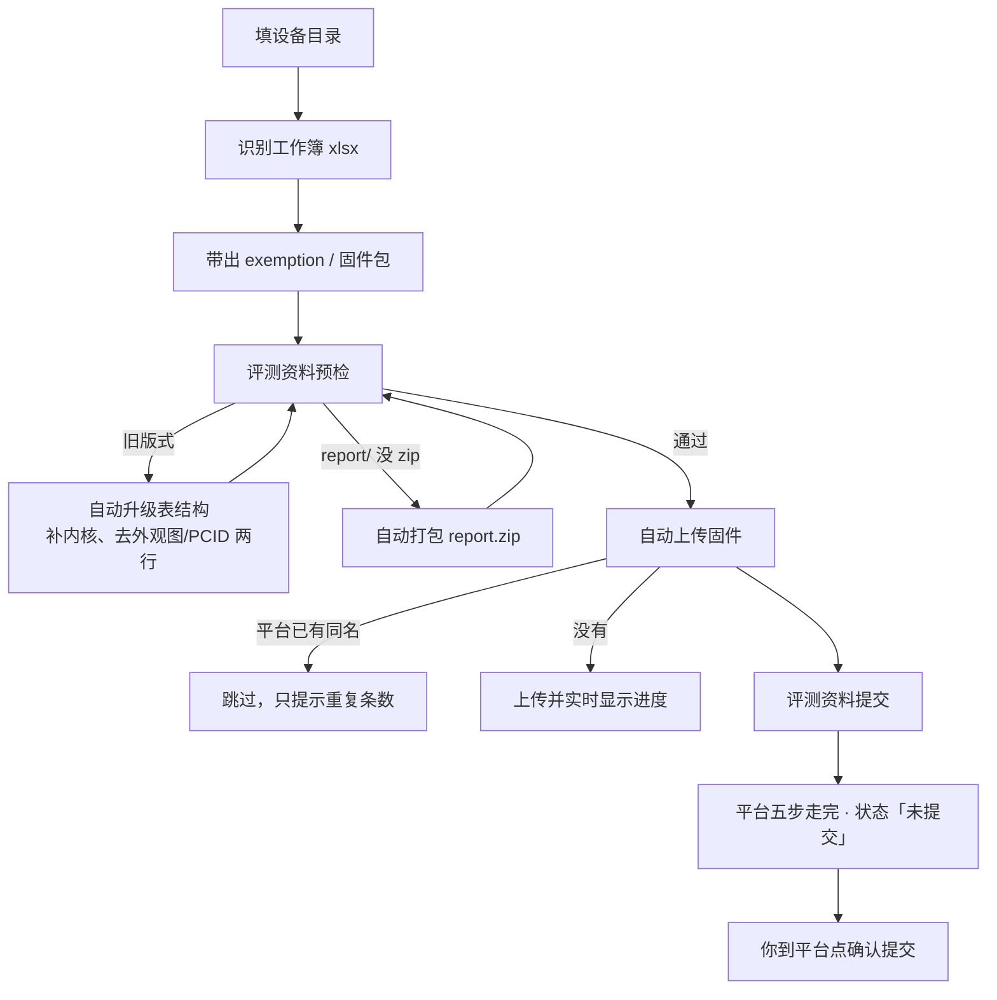
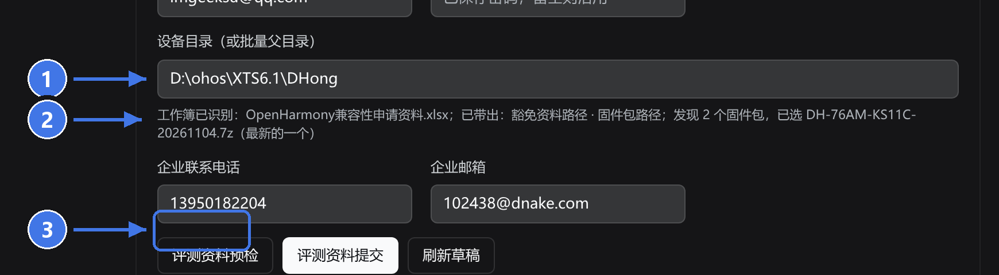
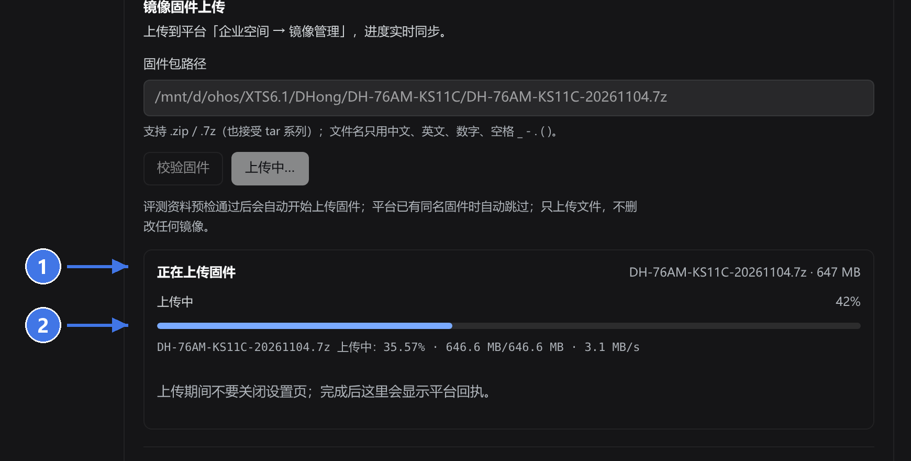
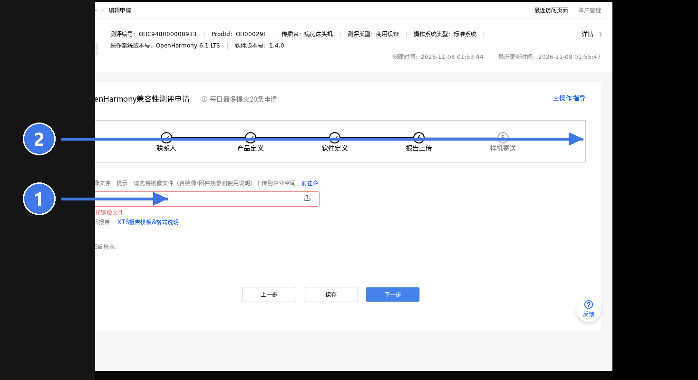
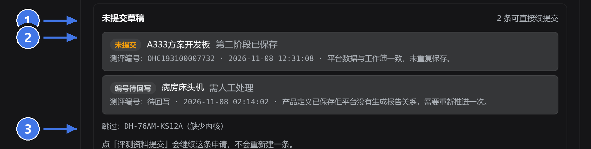
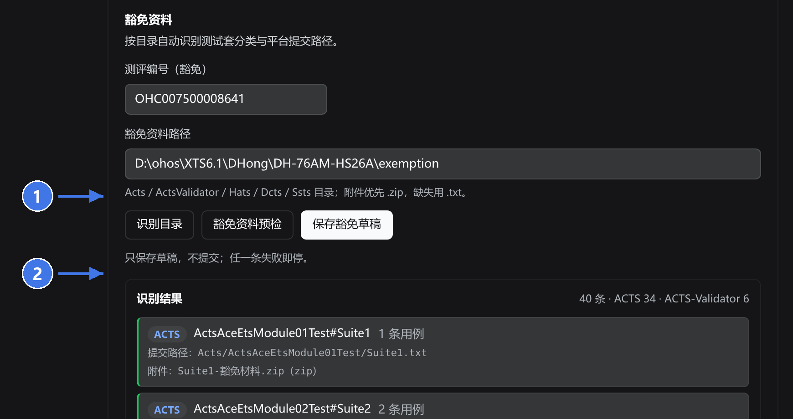
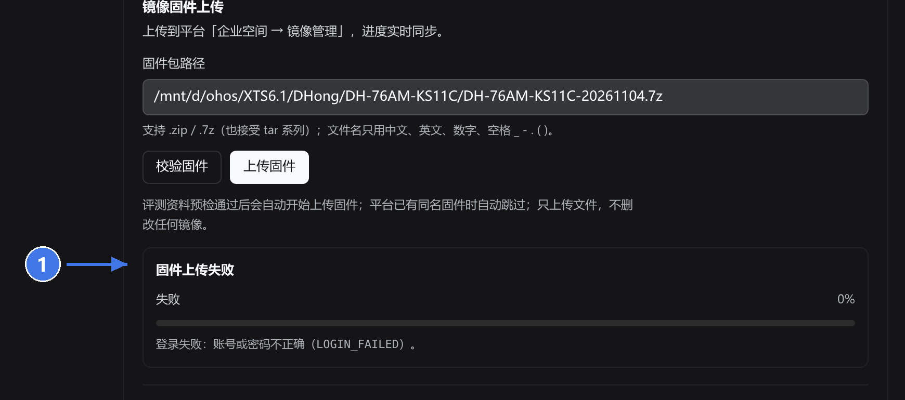

# OpenHarmony XTS 自动上报

把一台设备的 **第二阶段评测资料**、**豁免资料草稿**、**固件镜像** 交给平台，不用手动点完 5 步。

- 填一个设备目录 → 自动带出工作簿、`exemption/`、固件包路径
- 预检通过 → 自动上传固件（平台已有同名固件就跳过）
- 提交 → 联系人 / 产品定义 / 软件定义 / 报告上传 / 样机寄送，一路保存到「未提交」

> 只**保存草稿**，从不代你点「确认提交」；豁免资料同理，只存草稿。



## 三步上手

### ① 填设备目录

只填**目录**，工作簿按目录里的 `OpenHarmony兼容性申请资料.xlsx` 自动识别；同时带出豁免路径、固件包路径（不会自动提交）。



1. 「设备目录（或批量父目录）」填设备目录，例如 `D:\ohos\XTS6.1\DHong\DH-76AM-HS26A`
2. 下面那行提示会告诉你带出了什么；没有工作簿/固件时会写清缺哪个
3. 带出后直接点「评测资料预检」

### ② 预检通过就自动传固件

预检会先做三件事：旧版式工作簿就地升级、`report/` 自动压成 `report/report.zip`、校验外观图与 `pcid.sc`。通过后**自动开始上传固件**，进度实时同步。



1. 面板顶部是当前阶段：`解析中 → 上传中 → 校验中`
2. 进度条是整体进度，下面一行是平台原始进度、文件大小与速率
3. 结束后这里显示平台回执；同名固件已存在时显示「平台已有这条固件，未重复上传」

### ③ 提交，五步交给插件



1. 平台第 4 步要三样：镜像文件（从已上传的列表里选）、XTS 报告（`report/report.zip`）、PCS 自检表（目录里的 `6.x自检表`）
2. 第 5 步是样机寄送：填了「快递单号」才会保存，快递物品清单用目录里的 `OpenHarmony兼容性测试样品清单.xlsx`
3. 走完状态是「未提交」，`确认提交` 仍由你在平台上点

## 交了什么给平台

| 平台要的 | 从哪来 |
|---|---|
| 产品 / 软件定义、安全补丁、版本Id | 工作簿「产品定义」「软件定义」段（补丁 `2026-11-1` 会自动归一成 `2026/11/01`） |
| 镜像文件 | 设备目录里的 `*.7z` / `*.zip`（文件名含 8 位日期优先；上传前查重，同名跳过） |
| XTS 报告 | `report/report.zip`（没有就自动把 `report/` 打包） |
| PCS 自检表 | 目录里的 `OpenHarmony设备兼容性规范*自检表_标准系统.xlsx`（5.x/6.x 自动挑新的） |
| 外观图 / PCID.sc | 目录里的图片与 `pcid.sc`（表里不再有这两行） |
| 快递单号 / 物品清单 | 工作簿「快递单号」+ 目录里的样品清单 xlsx（选填，不填就跳过第 5 步） |

## 未提交草稿

填了目录就会自动查一遍：这个目录下创建过哪些平台申请、哪条能直接续提交。



1. 标题右侧的「N 条可直接续提交」= 处理状态不在「已完成 / 已提交 / 无需处理 / 已归档」的条数
2. 每行给测评编号与处理状态；「需人工处理」说明上次失败了，按备注重跑即可
3. 点「评测资料提交」会**继续**这条申请，不会重新建一条

## 豁免资料



1. 点「识别目录」只读不写：列出每个模块的测试套、用例数、平台提交路径与附件
2. 「保存豁免草稿」才真正登录平台存草稿；任一条失败即停

## 出错先看这一块



失败原因直接写进面板，例如：登录失败、平台已有重复设备申请、镜像文件被删导致平台 500。按提示处理后重试即可，进度条会说明停在哪一步。

## 目录规范

<details>
<summary>设备目录长这样（点开）</summary>

```
DH-76AM-HS26A/
├─ OpenHarmony兼容性申请资料.xlsx        # 唯一要填的表（产品/软件定义、快递单号）
├─ DH-76AM-HS26A-20261106.7z            # 固件包（.7z/.zip，文件名带日期优先）
├─ DH-76AM-HS26A.png                    # 外观图
├─ pcid.sc                              # PCID
├─ OpenHarmony设备兼容性规范6.x自检表_标准系统.xlsx
├─ OpenHarmony兼容性测试样品清单.xlsx     # 样机寄送用
├─ exemption/                           # 豁免资料
│  ├─ Acts/<模块>/<套件>.txt + <套件>-豁免材料.zip + evidence/
│  └─ ActsValidator/<套件>/<套件>.txt
└─ report/                              # XTS 报告目录（没有 zip 会自动打包）
```

</details>

## 安装

<details>
<summary>装到 DSH Desktop（点开）</summary>

```bash
pnpm install
pnpm build
node scripts/desktop-reinstall.mjs   # 打包并装进 desktop profile
```

装完重启 DSH Desktop，设置 → 「XTS报告上传」即可看到卡片。批量模式把「设备目录」填成父目录（如 `D:\ohos\XTS6.1\DHong`），每个子目录一份工作簿。
</details>

## 更多

<details>
<summary>接口、宿主差异、开发与安全边界（点开）</summary>

- Host 路由都在 `/api/ohos-xts-auto-reporter/`：`status`、`settings`、`preflight`、`save`、`waiver/preflight`、`waiver/save`、`waiver/scan`、`mirror/upload`、`paths/derive`、`phase2/drafts`。
- 宿主差异：桌面侧脚本子进程需 `ELECTRON_RUN_AS_NODE=1`；路径按 `toHostPath()` 在 `/mnt/d/...` 与 `D:/...` 间转换；设置自持在 `~/.dsh/ohos-xts-auto-reporter.json`（0600）。
- 开发：`pnpm build` / `pnpm test`（vitest）/ `pnpm test:python`；截图由组件真实渲染生成（数据为示例），标注脚本 `docs/tools/annotate_shots.py`。
- 安全边界：凭据只存本机 0600 文件或 `OH_USERNAME`/`OH_PASSWORD`，不写日志；只调用保存类接口，从不调用提交、确认提交；不删平台任何记录。

</details>
